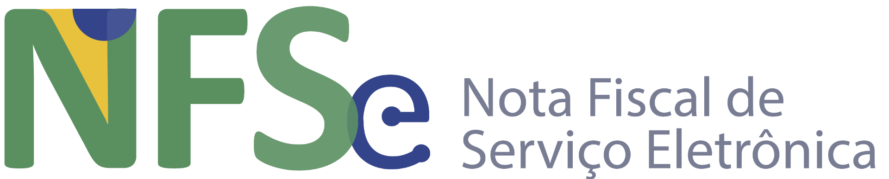
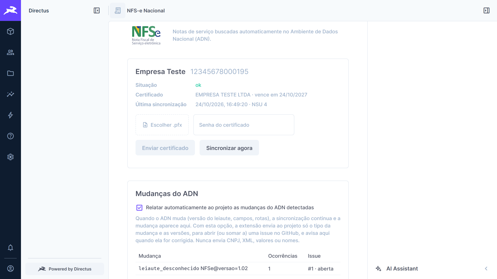
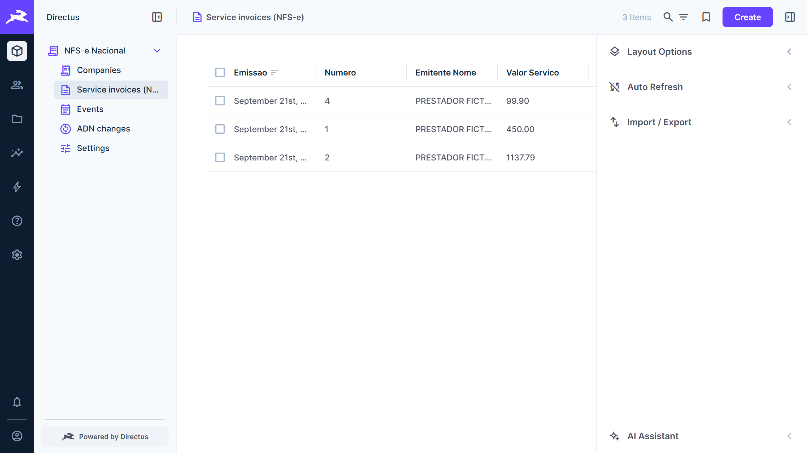

<p align="center"></p>

# nfse-nacional

[](https://github.com/CamilloBorges/nfse-nacional/actions/workflows/testes.yml)
[](https://sonar.bomgado.net/summary/new_code?id=nfse-nacional)
[](https://sonar.bomgado.net/component_measures?id=nfse-nacional&metric=coverage)
[](https://sonar.bomgado.net/summary/overall?id=nfse-nacional)
[](https://sonar.bomgado.net/summary/overall?id=nfse-nacional)
[](https://www.npmjs.com/package/nfse-nacional-core)
[](https://www.npmjs.com/package/directus-extension-nfse-nacional)

[](LICENSE)

Busca automática das **NFS-e do Sistema Nacional** (Ambiente de Dados Nacional – ADN) para dentro do
[Directus](https://directus.io).

O ERP costuma baixar as NF-e de produtos, mas as notas de **serviço** ficam de fora. Este projeto consulta
periodicamente a API de distribuição do ADN com o certificado A1 da empresa e grava cada NFS-e (e seus eventos) numa
coleção do Directus. A partir daí, as notas ficam disponíveis pela API REST, pelo GraphQL e pelo **MCP nativo do
Directus**, com as permissões de cada usuário.

| Módulo NFS-e Nacional                                 | Notas agrupadas na pasta do menu                                         |
| ----------------------------------------------------- | ------------------------------------------------------------------------ |
|  |  |

> Projeto independente, sem vínculo com a Receita Federal ou o Comitê Gestor da NFS-e.

## Pacotes

| Pacote                                                            | Para quê                                                                                                                                                                        |
| ----------------------------------------------------------------- | ------------------------------------------------------------------------------------------------------------------------------------------------------------------------------- |
| [`nfse-nacional-core`](packages/core)                             | Biblioteca Node independente: certificado A1, cliente mTLS do ADN, distribuição por NSU, leitura do XML, criptografia do certificado e os pontos de extensão (plugins).         |
| [`directus-extension-nfse-nacional`](packages/directus-extension) | Extensão (bundle) para **Directus 12**: coleções, agenda, rotas e tela de certificados. Instalação e configuração no [README do pacote](packages/directus-extension/README.md). |
| [`nfse-nacional-rele`](packages/rele)                             | Relé (Cloudflare Worker) que recebe os relatos de mudanças do ADN e abre ou atualiza as issues. Não é publicado no npm.                                                         |

## Arquitetura

O projeto segue o padrão **Plugin** de Martin Fowler: o núcleo define as interfaces, as implementações são registradas
por nome e escolhidas **pela configuração, em tempo de execução**. A extensão do Directus é só mais uma implementação
(adaptador).

```
          ┌──────────────────────── nfse-nacional-core ────────────────────────┐
          │  sincronizarEmpresa()  ──►  ClienteAdn (mTLS) ──► ADN /DFe/{NSU}   │
          │        │                                                           │
          │        ├─ FonteDeCertificado ◄─ registro: "arquivo" | plugins      │
          │        ├─ ProvedorDeChave    ◄─ registro: env | arquivo | dividida │
          │        └─ RepositorioNfse    ◄─ fornecido por quem usa             │
          └────────────────────────────────────────────────────────────────────┘
                           ▲ implementa / registra
┌──────────── directus-extension-nfse-nacional ────────────┐     ┌── pacotes de plugin ──┐
│ RepositorioDirectus · FonteDirectus ("directus")        │     │ ex.: cofre externo    │
│ hook (agenda) · endpoint (admin) · módulo (tela)        │     │ via NFSE_PLUGINS      │
└─────────────────────────────────────────────────────────┘     └───────────────────────┘
```

Detalhes e como escrever um plugin: [README do núcleo](packages/core/README.md).

### Acompanhando as mudanças do ADN

O ADN muda com frequência (leiaute, campos, rotas) e não publica aviso. O projeto se protege em três camadas:

1. **Na instalação:** cada resposta é conferida contra o `CONTRATO_ADN`. Mudança detectada não para a sincronização:
   vira `situacao = adn_alterado` e um registro em `nfse_divergencias`. Com o **consentimento** de quem usa, a extensão
   relata ao projeto (sem dado fiscal) pelo [relé](packages/rele), que abre a issue ou soma ocorrências à existente e
   avisa a instalação quando a correção é lançada.
2. **No repositório:** o workflow **Vigiar ADN** confere toda semana a
   [documentação oficial](https://www.gov.br/nfse/pt-br/biblioteca/documentacao-tecnica) (XSD, manuais, anexos, página
   de atualizações) contra `docs/adn-referencia.json` e abre uma issue quando algo muda.
3. **Na tela:** a extensão avisa quando há versão nova publicada.

### O que o ADN entrega

- Só as notas em que o CNPJ (ou outro com a **mesma raiz**) é **emitente, tomador ou intermediário**. Nota emitida no
  CPF de quem pagou ou sem tomador **não aparece**.
- Municípios no emissor nacional ou que compartilham dados com o ADN (obrigatório desde janeiro de 2026) e todos os MEI.
- Referência:
  [Manual dos Contribuintes – APIs do ADN](https://www.gov.br/nfse/pt-br/biblioteca/documentacao-tecnica/documentacao-atual/manual-contribuintes-apis-adn-sistema-nacional-nfse.pdf).

## Segurança

- Certificado e senha cifrados em envelope (AES-256-GCM); a chave-mestra nunca fica no banco e pode ser **dividida**
  entre o ambiente e um arquivo.
- O campo cifrado é `conceal`: mascarado em qualquer leitura, inclusive para administradores e pelo MCP. O segredo é
  amarrado ao CNPJ.
- Envio de certificado e sincronização manual só por administrador; a troca fica no log de atividades.
- Testes só com dados fictícios. Para relatar uma vulnerabilidade, abra uma
  [issue](https://github.com/CamilloBorges/nfse-nacional/issues) sem detalhes de exploração pedindo contato.

## Desenvolvimento

```bash
pnpm install
pnpm build
pnpm check       # lint (@directus/eslint-config), tipos, testes e conferência dos pacotes
pnpm e2e         # Directus 12.4.1 real + ADN simulado por mTLS, em Docker
```

Fluxo de trabalho, padrões e lançamento: [CONTRIBUTING.md](CONTRIBUTING.md).

## Versionamento

[Versionamento Semântico](https://semver.org/lang/pt-BR/), com os dois pacotes lançados juntos:

- **MAJOR:** exige ação de quem usa (migração de coleções, mudança de configuração ou de contrato de plugin);
- **MINOR:** funcionalidade nova compatível;
- **PATCH:** correção.

As mudanças ficam no [CHANGELOG.md](CHANGELOG.md) (formato Keep a Changelog). Cada tag `vX.Y.Z` publica os pacotes no
npm e cria o Release.

## Licença

[MIT](LICENSE)

> Logotipo da NFS-e: Governo Federal
> ([gov.br/nfse](https://www.gov.br/nfse/pt-br/biblioteca/documentacao-tecnica/logos-da-nfs-e)), usado sem alterações
> sob [CC BY-ND 3.0](https://creativecommons.org/licenses/by-nd/3.0/deed.pt_BR). Este projeto é independente, sem
> vínculo com a Receita Federal ou o Comitê Gestor da NFS-e.
